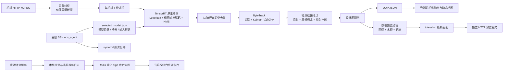

# RoadTwin Edge

**面向 NVIDIA Jetson 的多相机路侧感知服务：实时检测、单相机跟踪、地理定位与云端数据输出。**

[](https://github.com/DrQingLiuJun/roadtwin-edge/actions/workflows/ci.yml)
[](LICENSE)

RoadTwin Edge 将相机视频转换为带目标 ID、类别、检测框和经纬度的实时观测，为动态地图提供路侧输入。每台边缘单元独立处理三路视频，采用 TensorRT 推理、ByteTrack 跟踪、最新帧覆盖机制和 UDP 输出；同时提供按需检测预览、受限 SSH 运维、模型切换和 Redis 资源遥测。

这是现场运行程序的源码整理版。跨相机关联、融合滤波、最终速度/航向估计与 CARLA actor 控制由云端项目完成，不在本仓库重复实现。模型权重、设备专用引擎、Arial 字体及现场连接地址、投影矩阵和地理原点保留在设备，不随公开源码发布。算法源码保留现行局部坐标修正与类别补偿常量；迁移到新现场时需重新标定。

**导航：** [架构](#架构) · [目录](#目录结构) · [快速开始](#快速开始) · [部署模型](#从-pt-到上线运行) · [切换模型](#模型切换与恢复) · [数据与遥测](#数据接口与资源遥测) · [更新日志](#更新日志)

## 核心能力

- **多路实时处理**：每相机独立进程，采集线程只保留最新帧，避免排队积累旧画面。
- **原生推理**：TensorRT + CUDA + C++ 检测器，通过 ctypes 接入 Python；运行端无需加载 PyTorch 模型。
- **检测与定位**：类别内 NMS、人/骑行者跨类去重、ByteTrack、检测框底边中点投影、相机局部标定与类别补偿、经纬度输出。
- **模型可切换**：每模型独立目录与 manifest，校验 PT/引擎 SHA-256、类别映射和引擎输入；切换失败恢复原选择。
- **独立预览**：共享内存保存最新检测画面，按观看需求生成 MJPEG；不额外重复模型推理。
- **独立资源监测**：CPU、GPU、共享内存、磁盘、相机目标数/FPS、模型及服务状态每秒上传 Redis。

## 架构



### 处理链路与模块职责

| 模块 | 输入 → 输出 | 说明 |
| --- | --- | --- |
| `fenfa_gps.py` | 本机相机配置 → 多个工作进程 | 加载模型选择、控制生命周期、监测工作进程异常 |
| `LatestFrame` | MJPEG → 最新 BGR 图像/采集时间 | 队列容量为一帧；断开后重连 |
| `runtime/native/` | 原图 → 原图坐标系检测框 | 从 TensorRT binding 读取实际宽高，Letterbox 后推理并还原检测框 |
| `runtime/desktop_logic.py` | 检测结果 → 跟踪及定位观测 | 保留原接地点、局部坐标修正、类别补偿与 GPS 计算逻辑 |
| `runtime/desktop_bytetrack.py` | 检测框 → 单相机轨迹 ID | 基于 Ultralytics 8.3.0 跟踪实现，使用 NumPy/SciPy/LAP |
| `edge_tracker_config.py` | JSON → 经校验的跟踪参数 | 与控制台共用配置校验和 revision |
| `preview/` | 同一帧及其观测 → MJPEG | 预览按需渲染，水印位于原时间信息下方；保留已安装 Arial |
| `ops_agent.py` | 固定 SSH 动作 → 状态/执行结果 | 仅开放 status/start/stop/restart/activate-model/apply-tracker |
| `edge_telemetry/` | 本机资源与当前 invocation 日志 → Redis | 1 Hz 上传，短超时、自动重连，不积压历史样本 |

边缘 ID 只在所属相机内有意义。多相机对同一真实目标的身份合并需要云端融合，不能只比较这里的 `i` 字段。

## 目录结构

```text
roadtwin-edge/                       # 现场安装目录仍为 /home/nvidia/bushuchengxu
├── README.md                       # 项目入口、部署说明与更新日志
├── AGENTS.md / CONTRIBUTING.md      # 修改规范与更新日志要求
├── LICENSE / THIRD_PARTY_NOTICES.md
├── fenfa_gps.py                     # 检测主入口
├── ops_agent.py                     # 受限 SSH 运维入口
├── edge_tracker_config.py
├── runtime/
│   ├── desktop_logic.py             # 检测→跟踪→地理定位
│   ├── desktop_bytetrack.py
│   ├── desktop_engine.py            # Python / C++ 接口
│   ├── manifest.json                # 算法来源、相机/类别映射
│   ├── native/                      # 唯一有效推理库的可重建源码
│   ├── libdesktop_detector.so       # 设备本地构建，不入 Git
│   └── vendor/                      # 设备本地 LAP 扩展及许可证
├── preview/                        # 预览服务、页面、播放器、水印
├── edge_telemetry/                  # Redis 上传服务及 RESP2 客户端
├── models/
│   ├── README.md                    # 模型目录契约
│   └── <model>/                     # 本地 PT + engine + selection.json
├── config/                         # 可公开的示例配置
├── assets/fonts/                   # 设备本地 Arial.ttf
├── deploy/systemd/                 # 检测、预览、遥测服务定义
├── tools/                          # 导出、构建、注册、核验和切换工具
├── tests/                          # CPU 可运行的工具契约测试
├── .github/workflows/ci.yml
└── requirements*.txt
```

以下为**现场设备本地配置/状态**，不提交 Git：

| 文件 | 内容 |
| --- | --- |
| `cameras_config.json` | 视频地址、UDP 目的地、投影矩阵、地理原点、相机朝向 |
| `active_cameras.json` | 本机处理的相机 ID 列表 |
| `edge_tracker.json` | 本机跟踪参数 |
| `preview/fleet.json` | 可选的跨设备预览地址和控制台地址 |
| `selected_model.json` | 当前生效模型 manifest 的副本 |
| `edge_telemetry/settings.json` | 设备身份、Redis 地址、固定资源键 |
| `edge_telemetry/status.json` | 上传成功/失败次数、最近成功时间和开销 |
| `.fenfa_gps.lock` / `.tracker-worker-*` | 运行互斥与工作进程配置确认，服务会维护 |

根目录保留少量运维入口和本机配置，以兼容现有控制台；算法不再放在带日期的历史发布目录。构建日志、旧评估图、ONNX 中间文件、备份目录和未引用引擎不作为部署依赖保留。

## 运行环境

现场核验基线：NVIDIA Jetson AGX Orin、Linux aarch64、Python 3.10、TensorRT 8.6.2、OpenCV 4.8.0、NumPy 1.21.5、SciPy 1.8.0、LAP 0.5.12。

CUDA、TensorRT 和 OpenCV 使用目标设备已经验证的系统安装。不要在运行环境用 pip 的 OpenCV 包覆盖现场带 CUDA/FFmpeg 的 OpenCV。TensorRT 引擎在每台目标设备构建和验证，不能假定跨硬件/软件版本通用。

导出 `.pt` 的训练/开发机器另外安装 `requirements-export.txt`；当前模型元数据为 Ultralytics 8.4.41，旧模型应按其训练环境确认版本。边缘生产推理不依赖 Ultralytics 或 PyTorch。

## 快速开始

**已有现场部署不要复制示例覆盖真实配置。** 新设备可按以下步骤初始化：

```bash
git clone https://github.com/DrQingLiuJun/roadtwin-edge.git /home/nvidia/bushuchengxu
cd /home/nvidia/bushuchengxu
python3 -m pip install -r requirements.txt
cp config/cameras.example.json cameras_config.json
cp config/active_cameras.example.json active_cameras.json
cp config/edge_tracker.example.json edge_tracker.json
cp config/telemetry.example.json edge_telemetry/settings.json
bash tools/build_runtime.sh
```

填写视频地址、UDP 目的地及本现场标定，设置本机三路相机；示例 IP 使用文档保留地址，示例标定不可用于实际定位。按下节注册合法模型，放置可合法使用的 Arial 字体，然后检查和启动：

```bash
python3 -B fenfa_gps.py --check
sudo install -m 0644 deploy/systemd/*.service /etc/systemd/system/
sudo systemctl daemon-reload
sudo systemctl enable --now rsu-detection-preview.service roadtwin-edge-telemetry.service rsu-edge-vision.service
systemctl status rsu-edge-vision.service --no-pager
journalctl -u rsu-edge-vision.service -n 40 --no-pager
```

如果已有旧 systemd drop-in，应先确认它不会覆盖新的 ExecStart。SSH 控制入口按原控制台的受限密钥与 sudo 配置安装；不要给公开预览服务通用 shell 权限。

## 从 `.pt` 到上线运行

### 1. 确定输入尺寸与类别

**文档写法是宽×高；代码/Ultralytics 的 `imgsz` 是 `[高,宽]`；TensorRT 使用 NCHW。** 当前配置对应：

| 项目 | 数值 |
| --- | --- |
| 画面/部署尺寸（宽×高） | **960×544** |
| 导出 `imgsz` / manifest `input_size` | **[544, 960]** |
| 引擎输入 | **[1, 3, 544, 960]** |
| 当前四分类稠密输出 | **[1, 8, 10710]** |
| 推理配置 | batch 1，FP16 引擎，原图 Letterbox |
| 类别顺序 | 0 person，1 car，2 cyclist，3 truck |
| 云端 wire 类别 | 0 person，2 car，1 cyclist，7 truck |

这里的 960×544 是**网络输入尺寸**，不是检测输出张量形状，也不是原始视频分辨率。原图不需要预先缩放，检测器负责 Letterbox 和坐标还原。

新模型部署应使用训练/验证时实际采用并验证的输入几何和预处理；若训练基线为 960×544，导出显式传入 `height=544,width=960`，不要沿用 640 或 768 的默认值。`.pt` 元数据的单个 `imgsz=960` 只表示训练参数，不能单凭它证明每张训练图都使用 544×960；还需核对 `rect`、数据比例和验证设置。当前 `best1119.pt` 的元数据记录 `imgsz=960`，已验证的生产引擎为 544×960。

`desktop_logic.py` 中沿用的 `predict(..., imgsz=640)` 形参来自原始算法接口；当前 `DesktopDetector` 是 ctypes 适配器，不使用这个形参重新缩放。**实际输入由 TensorRT binding 决定**，可用下方 verify 工具核对，不能仅看 Python 调用或 C++ 历史常量猜测尺寸。

### 2. 在训练/开发机器导出 ONNX

只使用可信来源的 `.pt`。安装与训练权重匹配的导出环境，然后：

```bash
python -m pip install -r requirements-export.txt
python tools/export_model.py /path/to/best.pt --width 960 --height 544 --output /path/to/new_model-960x544.onnx
```

工具检查四类名称/顺序，导出静态 batch 1、opset 12、`end2end=False`、`nms=False`，并验证 ONNX 输入输出。YOLO26 默认端到端输出 `[1,300,6]` 与现有稠密解码器不兼容；这里明确保留稠密输出，由现有 C++ 代码执行解码和 NMS。

### 3. 在每台目标 Jetson 构建引擎

将同一份 PT 与已检查 ONNX 放到新目录，避免覆盖正在使用的模型：

```bash
mkdir -p models/new_model
# 将 best.pt 和 new_model-960x544.onnx 复制到 models/new_model/
bash tools/build_engine.sh models/new_model/new_model-960x544.onnx models/new_model/new_model-960x544-fp16.engine
```

脚本使用本机 TensorRT 的 `trtexec --fp16`，workspace 512 MiB，并完成引擎加载/推理检查。FP16 是构建选项；输入/输出 binding 显示 FLOAT 不等于内部所有层都运行 FP32。TensorRT 会按层支持情况选择精度，仍须用代表性标注数据评估精度，不能将构建成功等同于精度提升。

### 4. 注册、校验并上线

```bash
python3 -B tools/models.py register --name new_model --pt models/new_model/best.pt --engine models/new_model/new_model-960x544-fp16.engine --width 960 --height 544 --precision FP16 --training-imgsz 960
python3 -B tools/models.py verify new_model
python3 -B tools/models.py activate new_model
```

注册会检查尺寸、类别、文件哈希、原生库和实际单帧推理，生成 `models/new_model/selection.json`，并自动向 README“更新日志”追加日期和注册内容。**注册不会自动替换当前模型**；可通过上述 activate 命令或云端控制台的模型下拉框上线。

上线使用原运维入口：原子写入选择 → `fenfa_gps.py --check` → 重启检测服务 → 等待本机全部相机输出；失败时恢复原选择。已停止的服务执行模型激活后会被启动。清理时保留当前模型及所有已登记模型的 PT/engine/manifest；确认 ONNX 不再用于排障后可删除中间文件。

## 模型切换与恢复

```bash
python3 -B tools/models.py list
python3 -B tools/models.py verify --all
python3 -B tools/models.py activate best1119
```

当前三台设备均保留以下五项。历史模型保持原验证尺寸，以保留原有切换行为；本次目录整理不重新训练或统一重建它们。

| 模型 ID | 权重文件 | 保留的部署输入（宽×高） | 精度 |
| --- | --- | --- | --- |
| `0428` | `0428.pt` | 768×768 | FP16 |
| `best1102` | `best1102.pt` | 768×768 | FP16 |
| `best1119` | `best1119.pt` | **960×544，当前默认** | FP16 |
| `yolo26m_finetune_main_01` | `best.pt` | 768×768 | FP16 |
| `yolo26n_20261103` | `yolo26n.pt` | 768×768 | FP16 |

每台设备保留各自 engine SHA-256，不能将另一台的 manifest 直接覆盖过来。模型目录是清理保护边界：PT、被 manifest 引用的 engine 和 `selection.json` 都是有效文件，不能因为时间旧就删除。

## 数据接口与资源遥测

### 检测观测：UDP JSON

```json
{"cam":20,"ts":"1795507141000","objs":[{"i":11752,"c":2,"lon":0.00123456,"lat":0.00123456,"local_class":1,"score":0.91,"box":[100.0,200.0,300.0,400.0]}],"local_camera_id":1,"sensor_ip":"192.0.2.20","frame_seq":100,"frame_queue_ms":0.2,"sent_ms":1795507141008,"logic_version":"desktop-09bdf273f42e","rider_person_suppressed":0}
```

示例经纬度和 IP 为占位值。`ts` 为本机获取该帧时的 Unix 毫秒时间字符串，不是相机硬件曝光时间；`box` 使用原图像素坐标。`cam` 为外部相机 ID，`local_camera_id` 为算法内部 1–9 编号。速度与最终航向由云端融合后输出，不在本 UDP 包中伪造。

### 预览 HTTP

- `http://<edge-ip>:8083/`：本机已分配相机的检测预览。
- `http://<edge-ip>:8083/api/status`：预览帧状态与当前模型。
- `http://<edge-ip>:8083/camera/<camera-id>`：单路检测画面查看页。
- `http://<edge-ip>:8083/stream/<camera-id>.mjpg`：MJPEG 检测视频流。

画面来自同帧检测结果，不重新运行检测。`/all` 可显示多台边缘单元；跨设备地址来自本地 `preview/fleet.json`，可参考 `config/preview_fleet.example.json`，未配置时只显示本机相机，源码不写死现场地址。

无人观看时尽量不做画框/编码；帧保存在 `/dev/shm/rsu-detection-preview`，不积累视频文件。

### 资源 Redis

`edge_telemetry/settings.json` 指定 Redis Proxy 和独立键，例如 `algo:{roadtwin-edge-1}:state`。上传完整 JSON 快照，1 Hz，`SET EX 15`，只保留最新数据：

```json
{"schema_version":1,"payload_schema":"roadtwin.edge_resources.v1","source":{"id":"edge-1","ip":"192.0.2.25","hardware":"Jetson AGX Orin","cameras":[20,21,22],"camera_kind":"rsu"},"time":{"sampled_at_ms":1795507141000,"session":"process-session","sequence":123,"target_upload_hz":1},"metrics":{"cpu_percent":35.4,"gpu_percent":96.5,"gpu_memory_shared":true,"memory_used":7301444403,"memory_total":32212254720,"disk_used":26843545600,"disk_total":57767310131,"model":"best1119","fps":{"20":{"fps":20.0}},"counts":{"20":{"objects":15,"observed_at":1795507140.8,"age_seconds":0.2}}}}
```

快照还包含服务状态、模型目录和跟踪配置 revision。内存/磁盘为字节，CPU/GPU 为百分比；Orin 内存与显存共享，只计算一份。按源采样时间判断新鲜度，不把键存在当作在线。各相机目标数来自当前服务 invocation 的新鲜日志，0 是有效值。云端资源卡片读取这些键；状态刷新不再周期性 SSH 探测，SSH 只保留原运维动作。

上传使用通用内网算法服务的 `algo:*` 约定，不写核心设备状态、设备集合或全局遥测 Stream。它不会自动进入 ThingsBoard；需要时由云端适配服务消费。

## 测试与维护

```bash
python3 -m unittest discover -s tests -v
python3 tools/check_changelog.py --base HEAD
python3 -B fenfa_gps.py --check
python3 -B tools/models.py verify --all
systemctl status rsu-edge-vision.service rsu-detection-preview.service roadtwin-edge-telemetry.service --no-pager
cat edge_telemetry/status.json
```

CPU 测试覆盖 manifest 路径/哈希/类别、输入宽高顺序、稠密输出契约和更新日志写入；TensorRT 测试必须在目标 Jetson 上运行。部署变更还需确认三路实时输出、预览、Redis 时间持续推进及控制台模型目录。

2026-11-26 现场验收：三台设备共 15 组“设备×模型”均完成原生推理校验和实际切换，全部恢复 best1119；九路总览连续显示新帧，单路预览为 1280×720，浏览器无 JavaScript 异常。CPU 工具测试 10 项通过。

本次整理沿用检测/跟踪/坐标转换的算法语句和当前标定，主要调整有效模块位置、模型元数据引用和部署工具。模型检测精度、GPS 误差及端到端融合效果需另行使用标注数据评估，不以目录清理或单帧 smoke test 代替精度结论。

每次修改项目文件或新增模型，必须在下方追加简短日期记录并随代码提交。`AGENTS.md`、贡献说明和 CI 共同约束；模型注册工具会自动记录。详见 [CONTRIBUTING.md](CONTRIBUTING.md)。

## 更新日志

- 2026-11-26：整理为 RoadTwin Edge；将有效算法从日期发布目录移入固定 runtime，预览归入 preview；删除无引用备份、评估数据和构建中间文件，保留五个模型及其本机引擎；统一使用实际推理库，补齐导出/构建/注册/核验工具、开源配置模板、CI 与文档。
- 2026-11-24：增加独立 Redis 资源上传服务，1 Hz 上报资源和各相机处理状态，支持云端控制台读取。
- 2026-11-19：上线 best1119，生产输入调整为 960×544 FP16；检测预览水印移至相机原时间信息下方，使用白字描边。
- 2026-11-16：接入原桌面检测/跟踪/定位算法，并适配多路最新帧采集、TensorRT 原生推理与实时 UDP 输出。

## 许可与致谢

本项目采用 [AGPL-3.0](LICENSE)，沿用 Ultralytics 跟踪实现的许可证要求。第三方依赖、模型及字体的许可边界见 [THIRD_PARTY_NOTICES.md](THIRD_PARTY_NOTICES.md)。感谢 Ultralytics、ByteTrack、NVIDIA TensorRT、OpenCV、NumPy、SciPy 与 LAP 社区。
